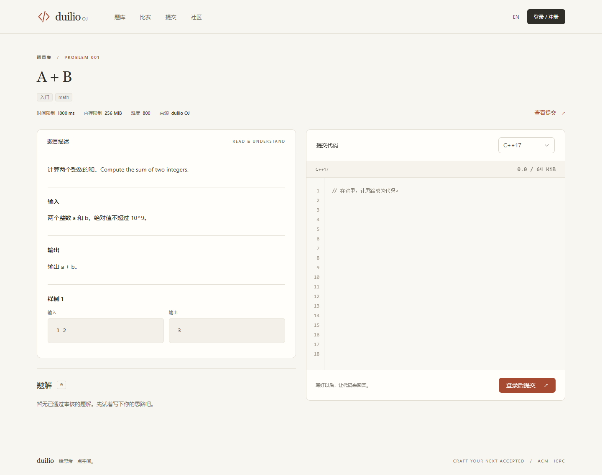

# 前端视觉更新

2026-10-15。按用户确认的 Claude 风格方向，采用温暖、安静、适合阅读与编程的界面。
视觉参考：[Claude 产品页面](https://claude.com/product/overview)。代码符号图形与 duilio 品牌标记为本项目的 SVG。

## 视觉约定

| 用途 | 约定 |
| --- | --- |
| 页面底色 | 暖米白 `#f8f6f1` |
| 内容表面 | `#fffefa` |
| 正文 | 炭灰 `#302e29` |
| 次级文字 | `#726d63` |
| 主要操作 | 陶土橙 `#a64b32` |
| 边线 | `#e3dfd5`，细线分隔，减少阴影 |
| 标题 | Georgia / 本机中文衬线字体，留出阅读空间 |
| 正文与代码 | 系统无衬线字体；代码使用 Cascadia Code / Consolas |

颜色和 Element Plus 主题变量统一维护于 `frontend/src/style.css`，无远程字体请求。
字体会随操作系统可用字体变化，版式不依赖额外安装字体。

## 页面与交互

- 题库：阅读式开场、紧凑检索、可用键盘访问的题目链接、解题榜和训练提示。
- 做题：桌面题面与代码并排，代码面板在阅读长题面时保持可见。
  手机按题面、代码、题解排序；代码区显示同步行号和 UTF-8 字节大小。
- 登录、注册、重置：统一表单风格，桌面双栏，手机单栏。
- 提交：保留自动刷新；结果详情区集中显示分数、耗时、内存与语言，
  逐测试点和总结果使用一致的状态标记。
- 比赛、社区、工作区、管理、个人资料：共享标题、表格、标签、表单、弹窗与空状态样式。
- 中英切换同步文档语言；提供跳至正文链接、键盘焦点与减少动画偏好支持。
- 题库区分加载失败与搜索无结果，提供重试；小屏宽表格在组件内部滚动。

本轮修改范围为前端代码、浏览器回归和文档。沿用现有接口、业务权限与评测流程。

## 验证与预览

在 `frontend/` 执行 `npm run format:check`、`npm run build`、`npm run test:e2e`。
浏览器测试需要完整服务及本地 `.env` 的测试管理员凭据，测试详情见 [验证记录](VERIFICATION.md)。

[手机题库](screenshots/mobile.png) · [手机做题](screenshots/problem-mobile.png) · [登录页](screenshots/auth.png)
