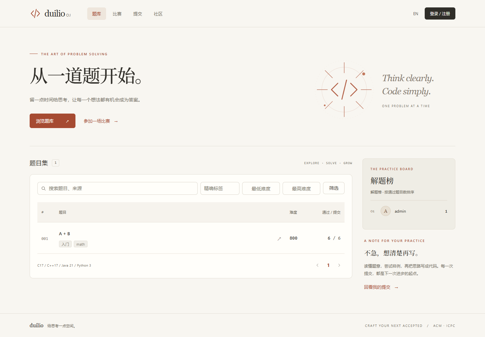

# 本机验证记录

## 2026-10-21 SQL 优化

题目列表改为当前页批量统计，19 项 JUnit 通过，包括实际 SQL 次数回归。
1 万题 / 10 万条模拟提交的独立 MySQL 基准中，统计 SELECT 从 30 次降为 1 次，
完整匿名接口从 33 次降为 4 次；14 类新旧完整响应一致，1280 次计时请求零错误。
单客户端 P95 54.85 → 37.25ms；8 客户端 P95 289.70 → 179.61ms。
环境、全部分轮数据与适用边界见 [SQL 优化报告](SQL-OPTIMIZATION.md)。

## 2026-10-20 补充验证

应用 f5059b6 的完整验收于 10-16 通过（15 项 JUnit、126 项机器检查、
41 次判题、6 条浏览器流程），见 [机器验收](MACHINE-ACCEPTANCE.md)。
10-20 使用相同 API / judge / web 镜像完成真实旧数据演练：
25 条转换记录逐字段一致、真实历史榜单一致、13 张业务表备份恢复一致，
四语言判题 AC；300 秒内 3000 次读取零错误，P95 30.48ms；
另有 20 客户端 400 次读取零错误，P95 19.32ms。
浏览器通过同一个隔离入口访问旧版、新版和回退后的旧版，均无 JavaScript 错误。
原 PostgreSQL 保持停止，测试容器和卷已清理，私有备份保留。

这些是本机 Linux 容器与回环代理的结果。外部服务器、TLS、公网正式切换和多日运行未验证；
用户忘记旧密码，真实旧账号密码登录未验证，未改动原哈希或重置账号。
详见 [交付状态](DELIVERY.md) 与 [本轮脱敏报告](operations-20261020.json)。

## 2026-10-15 历史验证

日期：2026-10-15，Asia/Shanghai。
验证对象：codex/java21-migration 分支中的 java-platform 实现。
旧 main、原数据库和真实旧业务数据未切换。

## 结果

| 验证 | 结果 | 环境与覆盖 |
| --- | --- | --- |
| JUnit | 14 / 14 通过 | JDK 21 + H2；也在 Linux 镜像构建时通过 |
| 真实端到端 | 34 / 34 通过 | MySQL 8.4、Redis、RabbitMQ、Java worker、Docker 沙箱 |
| 浏览器 | 11 / 11 通过 | 邮件适配后，Edge / Playwright，完整 Nginx 容器入口 |
| 数据迁移 | 12 / 12 通过 | 新建 PostgreSQL 16 → 空 MySQL 8.4，含事务回滚 |
| 队列可靠性 | 3 / 3 通过 | RabbitMQ 离线恢复、outbox 继续投递、重复消息幂等 |
| 前端 | 构建通过 | Node.js 24，npm ci / build，Prettier 检查 |
| 邮件配置脚本 | 4 / 4 通过 | 保留原配置、拒绝空值与重复项、认证失败不切换、不打印凭据 |
| Docker Compose | 完整栈就绪 | API health 为 UP，judge 消费队列，web 可访问 |

## 关键证据

- C、C++17、Java 21、Python 3 均得到 ACCEPTED；
  两个测试点通过，最终 100 分，逐测试点结果落库。
- 单独构造 WA、CE、RE、TLE、MLE、OLE，以及联网与写只读根目录失败的程序，
  判题均返回预期结果。
- 邮箱验证码实际通过 Mailpit 收取，注册成功；
  密码重置拒绝错误和复用验证码，旧密码与旧 JWT 随后失效。
- 普通成员不能管理题目或提权，隐藏题目不能通过 ID 枚举；
  他人的提交源码和隐藏输出不可读。
- 按公开题目筛选时，非成员不能看到该题在他人私有比赛里的提交；
  加入比赛后可见该比赛的提交元数据。
- 博客草稿保持私有；题解审核后公开，编辑后重新进入审核；
  投稿重复审批被拒绝。
- 私有比赛自建题能在比赛上下文读取；
  编辑比赛保留自建题标记，结束后仍会公开；
  封榜期间过滤后续提交。
- 重复队列投递不重判、不重复保存结果；
  旧租约的 worker 结果不能覆盖恢复后的新尝试。
- 停止 RabbitMQ 后创建提交，提交保持 PENDING；
  恢复 broker 后，原提交继续判题并得到 ACCEPTED。
- PostgreSQL 只读快照导出后，源记录不变；
  导入保留 ID、密码哈希、中文、测试输入输出、历史结果、成员关系和榜单快照；
  重复导入被拒绝，后段外键错误使前段插入一起回滚。

## 页面

浏览、筛选、中英切换、无效会话恢复、登录与刷新、提交到 AC、
管理新增题目、博客文本展示、已有投稿编辑、比赛/工作区/资料页、
390px 布局均已检查。

前端视觉更新后重新通过 10 项浏览器回归，新增题面/代码桌面并排、手机堆叠、
编辑器行号滚动同步，以及加载失败重试与无结果搜索检查。
手机测试覆盖题库、做题、登录、比赛、社区、提交、工作区、管理和资料页。
另以中英文、320 / 768 / 1024 / 1440px 检查这 9 个页面，
没有发现整页横向溢出或 JavaScript 错误。
正式 web 镜像构建成功，最终 10 项测试在实际 Nginx 入口通过；
截图取自该容器入口，测试博客、投稿、私有题目已清理。
后端与数据库未在此视觉更新阶段修改，其他测试记录来自前面的迁移验收。
视觉约定、做题页和登录页截图见 [前端视觉更新](FRONTEND-DESIGN.md)。

[移动端截图](screenshots/mobile.png)

## 测试数据与运行状态

QQ 邮箱适配已补充 SMTP AUTH、465 隐式 TLS、服务器身份校验与写超时，
开发脚本不再覆盖自定义 SMTP 端口。更新后的 API 镜像内 14 项 JUnit 通过。
本机已通过 smtp.qq.com:465 的 TLS 握手与真实 SMTP 身份认证；
注册页实际发信请求返回 200，QQ 接受邮件，用户确认真实邮箱已收到验证码。
当前网络下该次请求约 32 秒，因此邮件读取超时调为 30 秒，
发送按钮增加等待状态、重复点击防护及失败后恢复；新增浏览器回归通过。
获取与应用步骤见 [QQ 邮箱真实发信](QQ-MAIL.md)。

定向清理脚本已移除本轮 smoke 题目、比赛、记录及测试账户，
保留 A + B 演示题、管理员和已实际产生的演示提交。
迁移测试自己的 PostgreSQL 容器与临时 MySQL 库已清理；
普通完成的判题容器与临时卷也已清理。
项目的 MySQL / Redis / RabbitMQ 持久卷保留。

当前保留完整 Compose 栈运行，入口 http://127.0.0.1:5175。
管理员凭据读取本地 .env，未提交到 Git。

## 适用边界

2026-10-15 另在独立 Compose 项目完成 9 阶段机器验收：20 名模拟学生、
41 次实际判题、3 条浏览器流程、400 次读取、故障恢复、自然封榜/结束、
12 项数据迁移检查及旧/新接口比较全部通过。详细数据、测试方法和未覆盖范围见
[机器验收报告](MACHINE-ACCEPTANCE.md)。原运行服务及 QQ 配置未修改。

这些测试发生在本机 Docker Desktop 的 Linux 容器环境，
没有向外部 Linux 服务器发布，也没有切换真实旧库。
原密码哈希在迁移测试中被保留，Java 的兼容校验由 JUnit 验证；
真实用户登录与业务核对仍是正式数据切换时的验收步骤。

Flyway 11.7.2 在本机对 MySQL 8.4 输出版本兼容性提示；
该日 V1、V2、V3 已实际成功执行，测试 schema 的完整导入和回滚也通过。
后续 V4 在 10-16 完整验收与 10-20 真实数据副本演练中执行成功。
这条提示未被屏蔽，后续升级 Flyway 时应重复迁移验证。

Docker 资源限制不等同于对公开恶意代码的全面安全证明；
公网部署的判题主机和 Docker socket 边界见 DEPLOYMENT.md。
